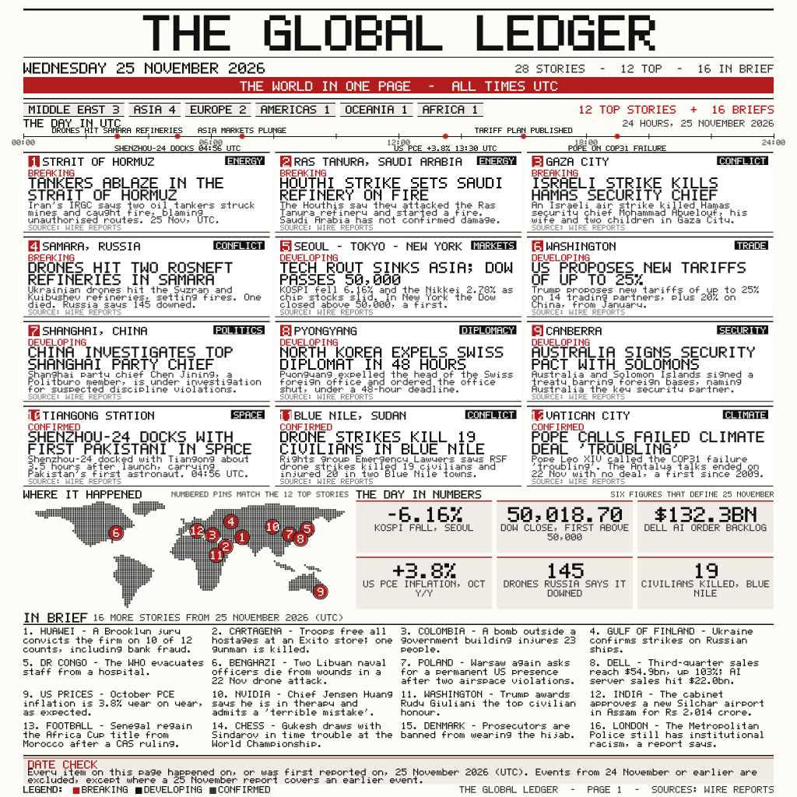

# The World in One Page — 25 November 2026

[](https://make.fun/competitions/news-image-20261125)
[](https://make.fun/competitions/news-image-20261125)
[](https://make.fun/competitions/news-image-20261125)

A single broadsheet front page that sums up the world's news of
Wednesday 25 November 2026 (UTC) in one image.



## What is on the page

- **12 top stories** — tankers on fire in the Strait of Hormuz, a
  Houthi strike on the Ras Tanura refinery, an Israeli strike in Gaza
  City, Ukrainian drones hitting two Rosneft refineries, a tech rout
  across Asian markets while the Dow closed above 50,000 for the first
  time, a new US tariff proposal, an investigation into Shanghai's
  party chief, North Korea expelling a Swiss diplomat, a security pact
  between Australia and Solomon Islands, Shenzhou-24 docking with
  Pakistan's first astronaut aboard, drone strikes in Sudan's Blue
  Nile state, and the Pope's verdict on the failed COP31 talks.
- **16 briefs** — from the Huawei verdict in Brooklyn to a report on
  the Metropolitan Police.
- **The day in numbers** — six figures that define the day, including
  the KOSPI's 6.16% fall, the Dow's 50,018.70 close, and Dell's
  $132.3bn AI order backlog.
- **A UTC timeline** of the day's key moments, a dotted world map
  with numbered pins for all 12 top stories, region counts, and a
  DATE CHECK footer: every item happened on, or was first reported
  on, 25 November 2026 (UTC).

## How the image is made

`main.py` uses only the Python standard library. It draws the page at
4096 x 4096 with a small built-in bitmap font, then shrinks it to
1024 x 1024 with a 4 x 4 box average and writes a PNG with a hand
rolled encoder. The program is fully deterministic: running it twice
produces byte-identical output.

```sh
python3 main.py
```

Output: `news-image-20261125.png` (1024 x 1024).

## Files

- `main.py` — the generator (entry point)
- `news-image-20261125.png` — the finished front page
- `README.md` — this file
- `LICENSE` — MIT licence
- `.makefun/owner.json` — the submitting wallet address
